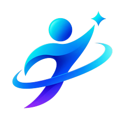

# AgileGeek

<p align="center">
  
</p>

<p align="center">
  <b>A desktop workbench built for Claude Code.</b><br />
  A native, fast, reading-first interface with a millisecond-fast IDE built in.
</p>

<p align="center">
  
  
  
  
  
</p>

<p align="center">
  <a href="#why">Why</a> ·
  <a href="#features">Features</a> ·
  <a href="#getting-started">Getting started</a> ·
  <a href="#architecture">Architecture</a> ·
  <a href="#development">Development</a> ·
  <a href="#license">License</a>
</p>

---

<a id="why"></a>

## Why

The terminal is a fine place to **run** Claude Code and a poor place to **read** it. Long diffs scroll out of view, earlier steps are hard to find again, and reviewing what changed means switching to another app.

AgileGeek is that window. It brings no agent of its own: Claude Code is the agent, with its tools, skills, plugins, MCP servers, subagents and hooks. AgileGeek runs the Claude Code you already have, with your `settings.json` and `CLAUDE.md`, and turns its work into something you can read, follow and undo.

<a id="features"></a>

## Features

- **An interface made for reading.** Reads, searches and commands fold into single lines; long conversations become steps you can scroll back through.
- **Review every change.** Each edit is shown file by file, kept or undone with a click. Checkpoints live in the app's data folder, never in your repository's `.git`.
- **Goals.** Type `/goal` and what you want done; Claude keeps working until it is met, with progress above the input.
- **A rich-text input.** Code copied from the editor arrives as a file-and-line reference; pasted images and dropped files stay where you put them.
- **Fast IDE.** An editor, a terminal and Source Control with a commit graph, built in. Language servers, VS Code themes and keymaps.
- **Any model.** Add an upstream speaking Anthropic's API, OpenAI's Chat Completions or OpenAI's Responses; a local proxy translates between it and Claude Code. Keys stay in the system keychain.
- **Remote projects over SSH.** The window stays on your machine; files, Git, search, terminals, language servers and Claude Code run on the remote host.
- **Up to four conversations side by side**, each with its own scroll and input.
- **Notifications** when an agent needs you or finishes; agents keep running after the window closes.

<a id="getting-started"></a>

## Getting started

1. Download the installer for your platform from [Releases](https://github.com/BlazeTian/AgileGeek/releases).
2. Install [Claude Code](https://github.com/anthropics/claude-code).
3. Open AgileGeek and pick a project folder.

Requirements: Windows 10+ (x64 or arm64), macOS 12+ (Apple silicon or Intel), or Ubuntu 20.04+ and other Debian-based distributions (x64 or arm64).

<a id="architecture"></a>

## Architecture

```text
┌──────────────────────────────────────────────────────────────┐
│  Windows   chat · IDE · agent · stash                        │
├──────────────────────────────────────────────────────────────┤
│  Chat      ChatSession ── Transcript ── ChatItem ── widgets  │
│                  ▲                                           │
│                  │ KernelEvent (single source of truth)      │
│  Kernel    ClaudeCodeKernel ── Transport ── CLI / engine     │
├──────────────────────────────────────────────────────────────┤
│  Workbench services · actions · context keys · UI parts · SCM│
├──────────────────────────────────────────────────────────────┤
│  Support   model proxy · SSH · settings · keys · themes · i18n│
└──────────────────────────────────────────────────────────────┘
```

A kernel reports events; the UI consumes them. Nothing else couples the two, so a runtime can be replaced, a message type added, or an IDE view extended without touching the other side.

<a id="development"></a>

## Development

Requires Flutter **3.47.5** (Dart SDK `^3.13.4`), plus Visual Studio 2022 build tools on Windows or Xcode 15+ on macOS.

```sh
flutter pub get
flutter run -d windows      # or macos / linux
```

Use a separate data folder while developing, so an installed copy is untouched:

```sh
AGILEGEEK_DATA_DIR=/path/to/empty-dir flutter run -d windows
```

Packaging:

```sh
dart run tool/build_windows.dart     # needs Inno Setup 6
dart run tool/build_macos.dart
flutter build linux --release && sh tool/package_linux_deb.sh
dart run tool/build_remote_server.dart
```

Checks:

```sh
flutter analyze --fatal-infos
flutter test test/<related-directory>
```

Commit messages follow `type(scope): summary`. UI uses the project's own widgets rather than stock Material or Cupertino ones. New strings go in both `lib/l10n/app_en.arb` and `app_zh.arb`.

See [docs/](docs) for design notes, starting with `workbench-architecture.md`.

<a id="license"></a>

## License

Released under the **GNU General Public License v3.0** (GPL-3.0-only); see [LICENSE](LICENSE).

The editor and terminal packages under `packages/` (`agile_editor`, `agile_xterm`, `agile_pty`, `agile_conpty`, `agile_iroh`) are MIT-licensed. Third-party components keep their own licenses; see [NOTICE.md](NOTICE.md).

> Parts of this project are derived from the open-source project [BaoCode](https://github.com/baocode-dev/baocode) (GPL-3.0-only), whose authors retain the original copyright. Attribution and license terms are in [NOTICE.md](NOTICE.md).

AgileGeek is an independent project: it is not affiliated with or endorsed by Anthropic, nor by the maintainers of the project named above. Claude and Claude Code are trademarks of Anthropic.
